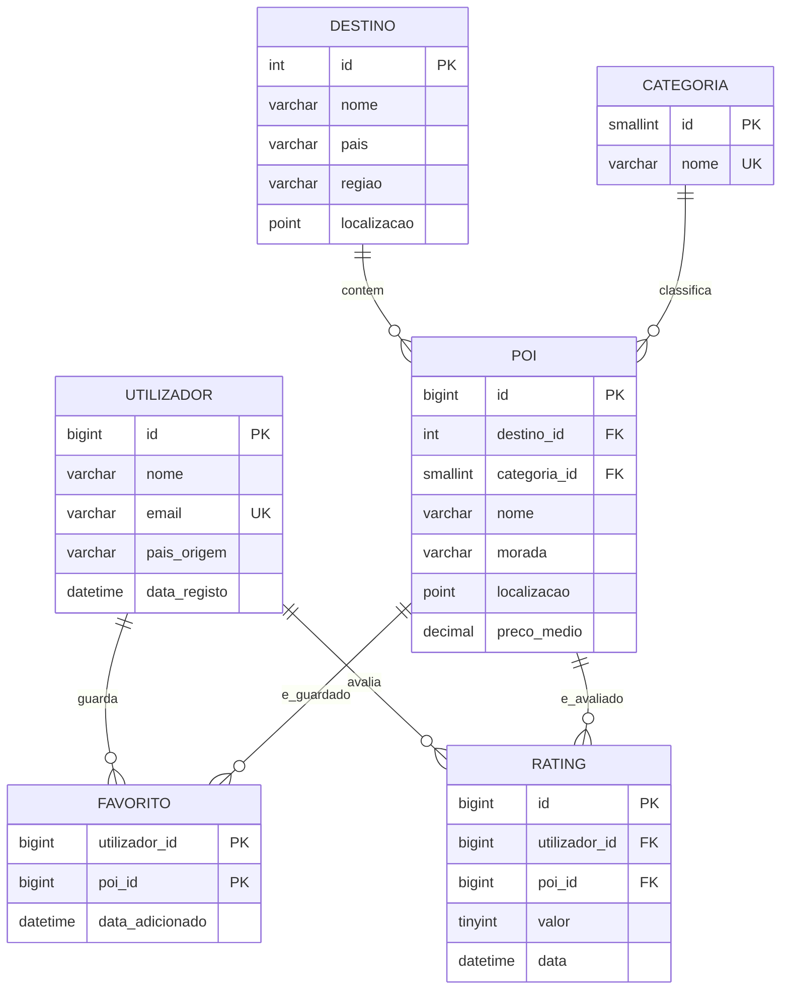

# MySQL - diagrama ER (rascunho)

> **Nota:** confirmar que o diagrama aparece desenhado na pré-visualização do GitHub. Se não aparecer, pôr uma quebra de linha a seguir a cada `{`. Nas tabelas `FAVORITO` e `RATING`, marcar as colunas que são chave estrangeira com `FK` (ex.: `bigint utilizador_id PK, FK`).
## Pontos a discutir com o grupo
- `poi.id` e o identificador canonico usado no MongoDB e no Qdrant.
- O rating individual fica so no MySQL (fonte de verdade); o MongoDB guarda o texto das reviews e referencia `poi_id` e `utilizador_id`.
- Restricao `UNIQUE (utilizador_id, poi_id)` em `rating`: um utilizador so avalia um POI uma vez.
- Indices espaciais em `poi` e `destino` (pesquisa por proximidade); indice composto `(destino_id, categoria_id)` em `poi`.
- A descrição textual de cada POI fica no MongoDB (documento com `poi_id`) e é a base dos embeddings guardados no Qdrant. *(a confirmar)*
- As preferências do utilizador (categorias preferidas) ficam no MongoDB. Também servem para recomendar a utilizadores novos. *(a confirmar)*
- O histórico de atividade do utilizador fica no MongoDB. *(a confirmar)*
- Ao apagar um POI, o `ON DELETE CASCADE` só limpa o MySQL; a aplicação apaga também o documento no MongoDB e o vetor no Qdrant.
- O payload do Qdrant vai guardar `destino_id` e `categoria_id` (em vez dos nomes), para filtrar por número e não ficar desatualizado se um nome mudar no MySQL.
- Rating médio: calculado com `AVG` ou guardado numa coluna de `poi` (padrão Computed)? A discutir.
