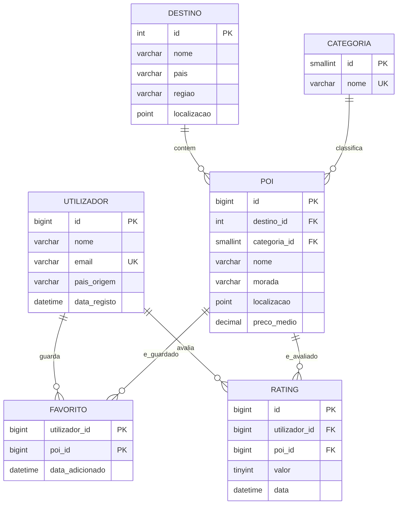

# MySQL - diagrama ER (rascunho)

## Pontos a discutir com o grupo
- `poi.id` e o identificador canonico usado no MongoDB e no Qdrant.
- O rating individual fica so no MySQL (fonte de verdade); o MongoDB guarda o texto das reviews e referencia `poi_id` e `utilizador_id`.
- Restricao `UNIQUE (utilizador_id, poi_id)` em `rating`: um utilizador so avalia um POI uma vez.
- Indices espaciais em `poi` e `destino` (pesquisa por proximidade); indice composto `(destino_id, categoria_id)` em `poi`.
