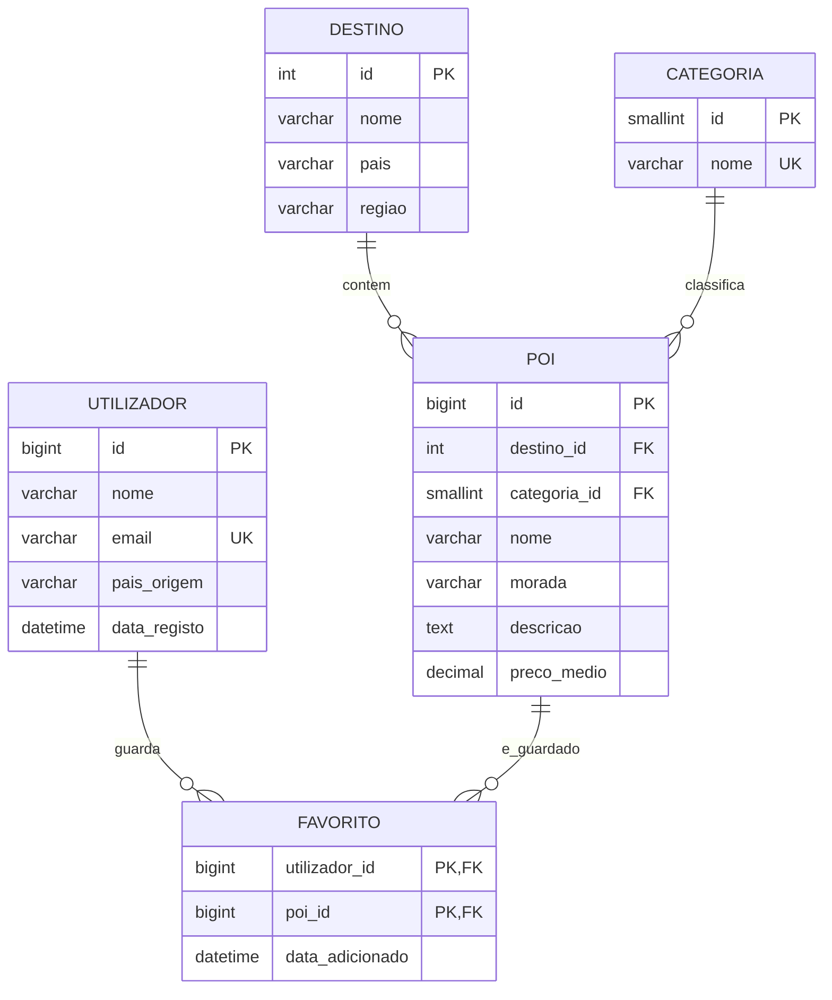

# MySQL - diagrama ER (rascunho)

## Notas de modelação
- `poi.id` é o identificador canónico usado também no MongoDB e no Qdrant.
- Índice composto `(destino_id, categoria_id)` em `poi`, para as listagens por destino e categoria.
- A descrição textual de cada POI fica em `poi.descricao` e é a base dos embeddings guardados no Qdrant.
- Os ratings e comentários dos POIs ficam no MongoDB (sugestão da professora no feedback da Parte I).
- A localização dos POIs fica no MongoDB, com índice `2dsphere` (sugestão da professora no feedback da Parte I).
- As preferências e o histórico de atividade do utilizador ficam no MongoDB.
- Ao apagar um POI, o `ON DELETE CASCADE` só limpa o MySQL; a aplicação apaga também o documento no MongoDB e o vetor no Qdrant.
- O payload do Qdrant guarda os nomes da cidade e da categoria, para filtrar a pesquisa semântica sem consultar o MySQL.
