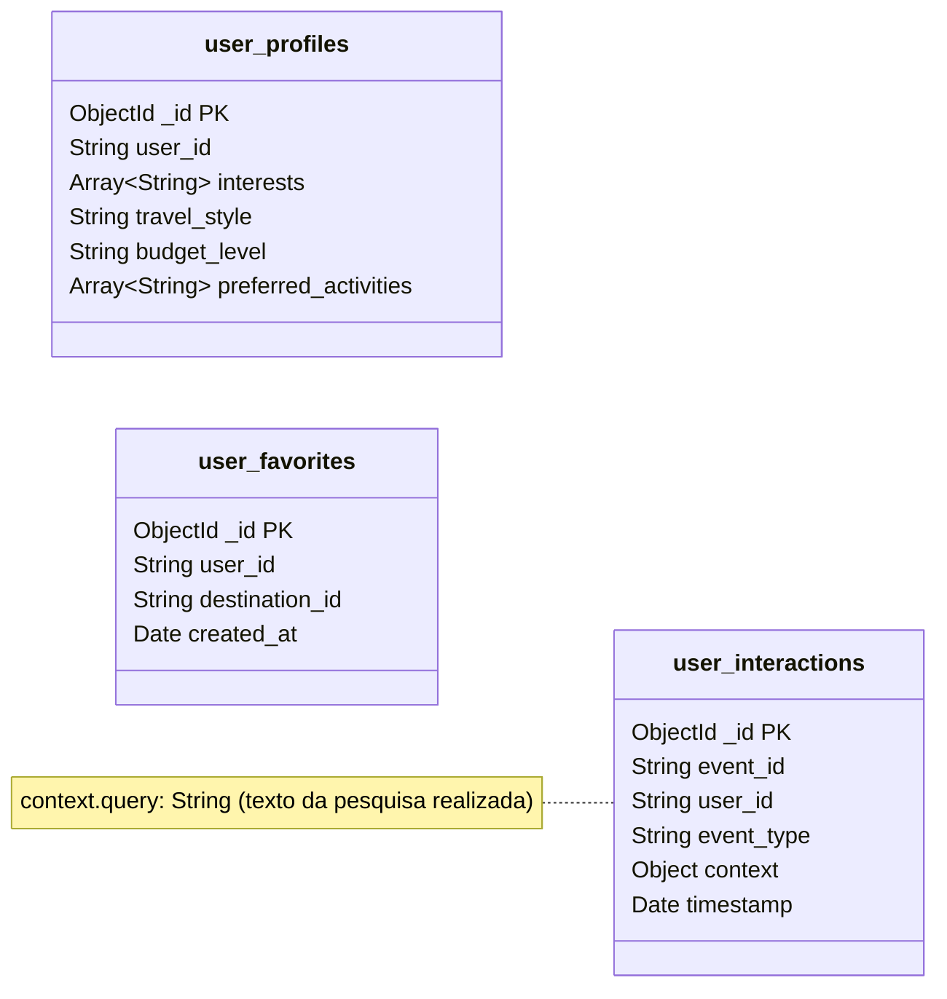

# Design da componente NoSQL — MongoDB

Smart Tourism Platform · Tópicos Avançados de Bases de Dados

## 1. Objetivo do MongoDB

No projeto Smart Tourism Platform, fico responsável pela componente NoSQL, utilizando MongoDB.

O MongoDB porque permite guardar dados em documentos com uma estrutura flexível. Neste projeto, será utilizado principalmente para armazenar informação dos utilizadores: as suas preferências, os destinos favoritos e o histórico de atividade na plataforma.

## 2. Organização dos dados

Para organizar a informação no MongoDB, proponho criar três collections.

### Diagrama de collections



### 2.1. Perfis dos utilizadores — user_profiles

Esta collection guarda as preferências de cada utilizador, permitindo personalizar a sua experiência na plataforma.

| Campo | Tipo de dados |
|---|---|
| `_id` | ObjectId (PK automática) |
| `user_id` | String (identificador do utilizador) |
| `interests` | Array de Strings |
| `travel_style` | String |
| `budget_level` | String |
| `preferred_activities` | Array de Strings |

Exemplo de documento:

```javascript
{
  "user_id": "U001",
  "interests": ["culture", "nature"],
  "travel_style": "relaxed",
  "budget_level": "medium",
  "preferred_activities": ["museums", "walking"]
}
```

Neste exemplo, o utilizador tem interesse em cultura e natureza, prefere viagens tranquilas e tem um orçamento médio. Esta informação poderá ser utilizada para personalizar as pesquisas e recomendações.

### 2.2. Destinos favoritos — user_favorites

Esta collection guarda os destinos que cada utilizador adiciona aos favoritos. Cada documento tem o identificador do utilizador, o identificador do destino e a data em que foi guardado.

| Campo | Tipo de dados |
|---|---|
| `_id` | ObjectId (PK automática) |
| `user_id` | String (referência lógica ao utilizador) |
| `destination_id` | String (referência lógica ao destino no PostgreSQL) |
| `created_at` | Date |

Exemplo:

```javascript
{
  "user_id": "U001",
  "destination_id": "D015",
  "created_at": ISODate("2026-10-19T10:30:00Z")
}
```

Desta forma, consigo associar cada destino favorito ao utilizador correspondente. Os detalhes do destino, como o nome e a descrição, são obtidos através do PostgreSQL, evitando guardar a mesma informação nas duas bases de dados.

### 2.3. Histórico de atividade — user_interactions

Esta collection regista as interações dos utilizadores com a plataforma, como pesquisas e visualizações de destinos.

| Campo | Tipo de dados |
|---|---|
| `_id` | ObjectId (PK automática) |
| `event_id` | String (identificador do evento) |
| `user_id` | String (referência lógica ao utilizador) |
| `event_type` | String |
| `context` | Document / Object |
| `timestamp` | Date |

Dentro de `context`, por exemplo:

- `query`: String, texto da pesquisa realizada.

Exemplo:

```javascript
{
  "event_id": "E001",
  "user_id": "U001",
  "event_type": "search",
  "context": {
    "query": "museums and cultural activities"
  },
  "timestamp": ISODate("2026-10-19T11:00:00Z")
}
```

Este documento representa uma pesquisa realizada por um utilizador. Ao guardar este tipo de informação, será possível consultar atividades anteriores e utilizar os interesses identificados para apoiar futuras recomendações.

Decidi separar estes três tipos de informação porque têm finalidades diferentes: os perfis podem ser atualizados, os favoritos podem ser adicionados ou removidos e o histórico vai acumulando novos registos ao longo da utilização da plataforma.

## 3. Operações que o MongoDB vai permitir

Depois de definir o modelo de dados, a ideia é implementar operações em Python para criar e atualizar perfis, gerir favoritos e registar o histórico de atividade. Para comunicar com o MongoDB, vou utilizar a biblioteca PyMongo.

Consultar o perfil de um utilizador:

```python
profile = user_profiles.find_one({
    "user_id": "U001"
})
```

Este código procura o documento do utilizador com o identificador `U001`.

Consultar os destinos favoritos desse utilizador:

```python
favorites = list(
    user_favorites.find({
        "user_id": "U001"
    })
)
```

O resultado é uma lista dos documentos correspondentes aos seus favoritos. Estes exemplos representam algumas das operações que pretendo implementar no backend Python.

## 4. Índices e desempenho

Um índice permite ao MongoDB localizar informação de forma mais eficiente, sem ter necessariamente de percorrer todos os documentos da collection.

Proponho criar um índice composto na collection `user_interactions`, utilizando os campos `user_id` e `timestamp`. O objetivo é facilitar a consulta do histórico de um utilizador, ordenado do mais recente para o mais antigo.

```python
user_interactions.create_index([
    ("user_id", 1),
    ("timestamp", -1)
])
```

O valor `1` indica uma ordenação ascendente e `-1` uma ordenação descendente. O índice foi pensado para filtrar pelo utilizador e ordenar as interações por data.

Para avaliar o impacto do índice, vou executar a mesma consulta antes e depois da sua criação:

```python
query = {"user_id": "U001"}

result = (
    user_interactions
    .find(query)
    .sort("timestamp", -1)
    .limit(20)
    .explain("executionStats")
)

print(result["executionStats"])
```

A consulta recupera as 20 interações mais recentes do utilizador e apresenta estatísticas sobre a execução.

## 5. Integração com as outras bases de dados

O MongoDB não funciona isoladamente. O backend Python é responsável por coordenar a utilização do PostgreSQL, MongoDB e Qdrant.

- **Pesquisa turística personalizada:** a aplicação consulta as preferências do utilizador no MongoDB, procura destinos semanticamente semelhantes no Qdrant e obtém os detalhes dos destinos no PostgreSQL.
- **Favoritos:** o MongoDB fornece os identificadores dos destinos guardados pelo utilizador e o PostgreSQL permite obter os respetivos nomes, descrições e restantes informações.
- **Recomendações:** o histórico armazenado no MongoDB pode ser utilizado para identificar interesses anteriores e apoiar recomendações através do Qdrant, complementadas com os dados dos destinos guardados no PostgreSQL.

Desta forma, a minha componente contribui para funcionalidades que combinam informação de diferentes bases de dados, em vez de funcionar apenas como um sistema isolado de armazenamento.

## 6. Justificação da escolha

Para a componente NoSQL, considerei duas alternativas: MongoDB e Amazon DynamoDB. Ambas permitem armazenar dados de forma flexível, mas apresentam diferenças na forma como os dados são organizados, consultados e indexados.

| Critério | MongoDB | Amazon DynamoDB |
|---|---|---|
| Modelo de dados | Base de dados orientada a documentos BSON | Base de dados NoSQL que utiliza estruturas de chave-valor e documentos |
| Flexibilidade | Permite documentos com campos e estruturas variáveis | Permite atributos flexíveis, mas o modelo deve considerar os padrões de acesso |
| Consultas | Suporta filtros, ordenação e operações de agregação | É otimizado para consultas definidas através de chaves e índices |
| Indexação | Suporta índices simples, compostos, únicos e outros tipos | Suporta índices secundários locais e globais, entre outros |
| Desempenho | Depende das consultas, dos índices, do volume de dados e da configuração | Depende dos padrões de acesso, das chaves, dos índices e da capacidade configurada |
| Escalabilidade | Pode escalar através de replicação e sharding, conforme a configuração | Oferece escalabilidade gerida pela AWS |
| Implementação no projeto | Adequado para experimentar modelos documentais, consultas e índices em Python | Adequado para aplicações que beneficiam da infraestrutura gerida da AWS e de padrões de acesso bem definidos |

