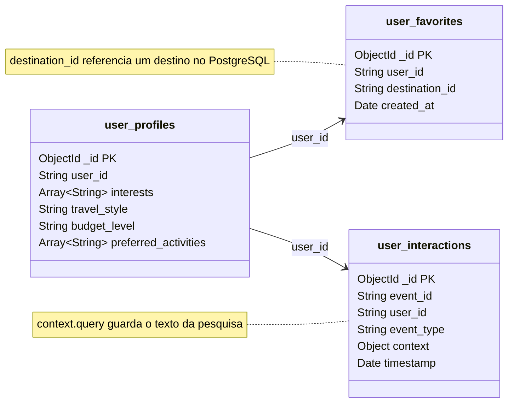

# Design da Componente NoSQL — MongoDB

*Smart Tourism Platform · Tópicos Avançados de Bases de Dados*

## 1. Objetivo do MongoDB

No projeto Smart Tourism Platform, a componente NoSQL será implementada utilizando MongoDB, uma base de dados orientada a documentos que permite armazenar informação em estruturas BSON, oferecendo flexibilidade na organização dos dados.

A escolha do MongoDB justifica-se pelas características da informação associada aos utilizadores da plataforma, nomeadamente preferências pessoais, destinos favoritos e histórico de atividade. Estes dados podem apresentar estruturas diferentes e sofrer alterações ao longo da utilização da aplicação.

Assim, o MongoDB será utilizado principalmente para armazenar informação relacionada com os perfis dos utilizadores, as suas preferências e as respetivas interações com a plataforma.

## 2. Organização dos dados

Para organizar a informação, serão utilizadas três collections:

- `user_profiles`: armazena os perfis e as preferências dos utilizadores.
- `user_favorites`: armazena os destinos favoritos de cada utilizador.
- `user_interactions`: regista as atividades realizadas pelos utilizadores na plataforma.

### 2.1. Diagrama de collections



As relações representadas são relações lógicas, estabelecidas através dos identificadores dos utilizadores e dos destinos. Não são utilizadas chaves estrangeiras com integridade referencial automática, como acontece numa base de dados relacional.

### 2.2. Perfis dos utilizadores — `user_profiles`

Esta collection guarda as preferências de cada utilizador, permitindo personalizar a sua experiência na plataforma.

| Campo | Tipo de dados | Descrição |
|---|---|---|
| `_id` | ObjectId | Identificador automático do documento |
| `user_id` | String | Identificador do utilizador |
| `interests` | Array de Strings | Interesses do utilizador |
| `travel_style` | String | Estilo de viagem preferido |
| `budget_level` | String | Nível de orçamento |
| `preferred_activities` | Array de Strings | Atividades preferidas |

Exemplo de documento:

```javascript
{
    "user_id": "U001",
    "interests": ["culture", "nature"],
    "travel_style": "relaxed",
    "budget_level": "medium",
    "preferred_activities": ["museums", "walking"]
}
```

Neste exemplo, o utilizador tem interesse em cultura e natureza, prefere viagens tranquilas e apresenta um orçamento médio.

Esta informação poderá ser utilizada para personalizar pesquisas e recomendações.

A utilização de arrays permite guardar vários interesses e atividades diretamente no documento do utilizador, evitando a necessidade de criar collections adicionais para estes elementos.

### 2.3. Destinos favoritos — `user_favorites`

Esta collection guarda os destinos que cada utilizador adiciona aos favoritos. Cada documento contém o identificador do utilizador, o identificador do destino e a data em que foi guardado.

| Campo | Tipo de dados | Descrição |
|---|---|---|
| `_id` | ObjectId | Identificador automático do documento |
| `user_id` | String | Referência lógica ao utilizador |
| `destination_id` | String | Referência lógica ao destino no PostgreSQL |
| `created_at` | Date | Data em que o destino foi adicionado |

Exemplo:

```javascript
{
    "user_id": "U001",
    "destination_id": "D015",
    "created_at": ISODate("2026-10-19T10:30:00Z")
}
```

Através desta estrutura, é possível associar cada destino favorito ao utilizador correspondente.

Os detalhes dos destinos, como o nome, a descrição e a localização, são obtidos através do PostgreSQL. Desta forma, evita-se duplicar informação entre as duas bases de dados.

A separação dos favoritos numa collection própria permite adicionar e remover destinos individualmente, sem necessidade de atualizar constantemente o documento do perfil do utilizador.

### 2.4. Histórico de atividade — `user_interactions`

Esta collection regista as interações dos utilizadores com a plataforma, incluindo pesquisas e visualizações de destinos.

| Campo | Tipo de dados | Descrição |
|---|---|---|
| `_id` | ObjectId | Identificador automático do documento |
| `event_id` | String | Identificador único do evento |
| `user_id` | String | Referência lógica ao utilizador |
| `event_type` | String | Tipo de interação |
| `context` | Document / Object | Informação adicional sobre a interação |
| `timestamp` | Date | Data e hora da interação |

Dentro do campo `context` podem existir diferentes atributos, dependendo do tipo de interação. Por exemplo, no caso de uma pesquisa, pode ser guardado o campo `query`, que contém o texto introduzido pelo utilizador.

Exemplo:

```javascript
{
    "event_id": "E001",
    "user_id": "U001",
    "event_type": "search",
    "context": {
        "query": "museums and cultural activities"
    },
    "timestamp": ISODate("2026-10-19T11:00:00Z")
}
```

Este documento representa uma pesquisa realizada por um utilizador.

A utilização de um documento embutido no campo `context` permite armazenar informação adicional associada a cada evento, mantendo a estrutura flexível para diferentes tipos de interação.

O histórico é organizado através de documentos independentes, permitindo acrescentar novos eventos sem modificar os registos anteriores.

### 2.5. Relações entre os dados

As três collections relacionam-se através do campo `user_id`.

Um utilizador possui um perfil em `user_profiles`, pode ter vários destinos guardados em `user_favorites` e pode gerar vários registos de atividade em `user_interactions`.

A relação com os destinos é estabelecida através de `destination_id`, que referencia os respetivos registos armazenados no PostgreSQL.

Assim, o MongoDB mantém os dados associados aos utilizadores, enquanto o PostgreSQL permanece responsável pela informação detalhada dos destinos turísticos.

## 3. Schema Design Patterns utilizados

Na modelação da componente MongoDB foram considerados diferentes padrões de organização de documentos.

### 3.1. Embedding

O padrão Embedding consiste em armazenar informação relacionada dentro do mesmo documento.

É utilizado em dois contextos:

- Na collection `user_profiles`, os interesses e as atividades preferidas são guardados em arrays dentro do documento do utilizador.
- Na collection `user_interactions`, o campo `context` permite armazenar informação adicional diretamente no documento do evento.

Esta abordagem reduz a necessidade de consultas adicionais para obter informação que está diretamente relacionada com o documento principal.

### 3.2. Referencing

O padrão Referencing consiste em utilizar identificadores para estabelecer relações entre documentos ou entidades armazenadas em diferentes collections ou bases de dados.

É utilizado na collection `user_favorites`, através dos campos `user_id` e `destination_id`.

Esta decisão evita duplicar os detalhes dos destinos turísticos no MongoDB, permitindo consultar essa informação no PostgreSQL sempre que necessário.

### 3.3. Separação de collections

A informação foi dividida em três collections de acordo com a sua finalidade e comportamento.

Esta decisão permite tratar separadamente os perfis, os favoritos e o histórico de atividade.

Os perfis são atualizados ao longo do tempo, os favoritos podem ser adicionados ou removidos e o histórico recebe continuamente novos registos.

Esta organização facilita a manutenção e evita que diferentes tipos de informação com ciclos de vida distintos sejam armazenados num único documento.

## 4. Operações que o MongoDB vai permitir

A comunicação entre a aplicação Python e o MongoDB será realizada através da biblioteca PyMongo.

As principais operações previstas incluem a criação e atualização de perfis, a gestão dos destinos favoritos e o registo e consulta do histórico de atividade.

### 4.1. Consultar o perfil de um utilizador

```python
profile = user_profiles.find_one({
    "user_id": "U001"
})
```

Esta operação procura o documento correspondente ao utilizador identificado por `U001`.

### 4.2. Criar ou atualizar um perfil

```python
user_profiles.update_one(
    {"user_id": "U001"},
    {
        "$set": {
            "interests": ["culture", "nature"],
            "travel_style": "relaxed",
            "budget_level": "medium",
            "preferred_activities": ["museums", "walking"]
        }
    },
    upsert=True
)
```

Esta operação permite atualizar as preferências de um utilizador. Caso o documento ainda não exista, a opção `upsert=True` permite criá-lo.

### 4.3. Adicionar um destino aos favoritos

```python
user_favorites.insert_one({
    "user_id": "U001",
    "destination_id": "D015",
    "created_at": datetime.now(timezone.utc)
})
```

Esta operação adiciona um novo destino à lista de favoritos do utilizador.

### 4.4. Consultar os destinos favoritos

```python
favorites = list(
    user_favorites.find({
        "user_id": "U001"
    })
)
```

O resultado corresponde à lista dos destinos favoritos associados ao utilizador.

### 4.5. Remover um destino dos favoritos

```python
user_favorites.delete_one({
    "user_id": "U001",
    "destination_id": "D015"
})
```

Esta operação remove o destino indicado da lista de favoritos do utilizador.

### 4.6. Registar uma interação

```python
user_interactions.insert_one({
    "event_id": "E002",
    "user_id": "U001",
    "event_type": "search",
    "context": {
        "query": "traditional restaurants in Porto"
    },
    "timestamp": datetime.now(timezone.utc)
})
```

Esta operação permite registar uma nova pesquisa realizada pelo utilizador, contribuindo para a construção do histórico de atividade.

Os exemplos apresentados representam as operações previstas para a integração do MongoDB no backend Python.

## 5. Índices e desempenho

Os índices permitem melhorar a eficiência das consultas, reduzindo a necessidade de percorrer todos os documentos de uma collection.

Na modelação proposta, serão considerados índices de acordo com os padrões de acesso à informação.

### 5.1. Índice nos perfis dos utilizadores

Será considerado um índice único no campo `user_id` da collection `user_profiles`.

```python
user_profiles.create_index(
    [("user_id", 1)],
    unique=True
)
```

Este índice permite localizar rapidamente o perfil de um utilizador e garantir que não existem vários documentos de perfil com o mesmo identificador.

### 5.2. Índice nos destinos favoritos

Será considerado um índice composto nos campos `user_id` e `destination_id`.

```python
user_favorites.create_index(
    [
        ("user_id", 1),
        ("destination_id", 1)
    ],
    unique=True
)
```

Este índice facilita a consulta dos favoritos de um utilizador e impede que o mesmo destino seja adicionado repetidamente aos favoritos do mesmo utilizador.

### 5.3. Índice no histórico de atividade

Na collection `user_interactions`, será criado um índice composto utilizando os campos `user_id` e `timestamp`.

```python
user_interactions.create_index([
    ("user_id", 1),
    ("timestamp", -1)
])
```

O objetivo é facilitar a consulta do histórico de um utilizador, permitindo obter as interações mais recentes primeiro.

O valor `1` representa uma ordenação ascendente e `-1` uma ordenação descendente.

### 5.4. Avaliação do impacto dos índices

Para avaliar o impacto do índice no histórico, será executada a mesma consulta antes e depois da sua criação.

```python
query = {"user_id": "U001"}

result = (
    user_interactions
    .find(query)
    .sort("timestamp", -1)
    .limit(20)
    .explain("executionStats")
)

print(result["executionStats"])
```

A consulta recupera as 20 interações mais recentes do utilizador e apresenta estatísticas relacionadas com a execução.

A análise deverá considerar indicadores como:

- `executionTimeMillis`: tempo de execução da consulta.
- `totalDocsExamined`: número de documentos analisados.
- `totalKeysExamined`: número de entradas do índice analisadas.

A comparação permitirá verificar se a utilização do índice reduz o número de documentos analisados e melhora o desempenho da consulta.

Os índices também introduzem custos adicionais de armazenamento e manutenção durante as operações de escrita. Por esse motivo, a sua utilização deverá ser justificada pelos padrões de consulta da aplicação.

## 6. Integração com as outras bases de dados

O MongoDB será integrado com o PostgreSQL e o Qdrant através do backend Python, que será responsável por coordenar as operações entre os diferentes sistemas.

A integração permitirá desenvolver funcionalidades que utilizam informação proveniente de mais do que uma base de dados.

### 6.1. Pesquisa turística personalizada

Quando um utilizador realiza uma pesquisa, o backend poderá consultar as suas preferências no MongoDB.

Com base nessa informação, poderá utilizar o Qdrant para encontrar destinos semanticamente semelhantes aos interesses do utilizador.

Posteriormente, os identificadores dos resultados poderão ser utilizados para obter os detalhes dos destinos no PostgreSQL.

### 6.2. Gestão de favoritos

Quando o utilizador consulta os seus destinos favoritos, o backend obtém os identificadores armazenados na collection `user_favorites`.

Esses identificadores são utilizados para consultar o PostgreSQL e recuperar os detalhes dos destinos, evitando duplicação de informação.

### 6.3. Recomendações personalizadas

O histórico armazenado no MongoDB poderá ser utilizado para identificar os interesses e os padrões de utilização da plataforma.

Esta informação poderá apoiar a geração de recomendações através do Qdrant, recorrendo a mecanismos de pesquisa por similaridade.

Os resultados poderão ser complementados com informação detalhada dos destinos armazenada no PostgreSQL.

Desta forma, o MongoDB contribui para funcionalidades integradas, não funcionando apenas como um sistema isolado de armazenamento.

## 7. Justificação da escolha do MongoDB

Para a componente NoSQL, foram consideradas duas alternativas: MongoDB e Amazon DynamoDB.

Ambas permitem armazenar informação de forma flexível, mas apresentam diferenças na organização dos dados, nas operações suportadas e na gestão da infraestrutura.

| Critério | MongoDB | Amazon DynamoDB |
|---|---|---|
| Modelo de dados | Base de dados orientada a documentos BSON | Base de dados NoSQL de chave-valor e documentos |
| Flexibilidade | Permite documentos com campos e estruturas variáveis | Permite atributos flexíveis, considerando os padrões de acesso |
| Consultas | Suporta filtros, ordenação e operações de agregação | Otimizado para consultas baseadas em chaves e índices |
| Indexação | Suporta índices simples, compostos, únicos e outros tipos | Suporta índices secundários locais e globais |
| Desempenho | Depende das consultas, índices, volume de dados e configuração | Depende dos padrões de acesso, chaves, índices e capacidade configurada |
| Escalabilidade | Suporta replicação e sharding | Oferece escalabilidade gerida pela AWS |
| Implementação | Permite trabalhar com documentos e consultas através de Python e PyMongo | Integra-se com os serviços da AWS e respetivas ferramentas |

### 7.1. Justificação da decisão

A escolha do MongoDB foi motivada pela adequação do seu modelo documental aos dados que serão armazenados na componente dos utilizadores.

As preferências, os favoritos e o histórico de atividade apresentam características diferentes e podem evoluir ao longo da utilização da plataforma. O modelo documental permite organizar esta informação de forma flexível, sem exigir uma estrutura rígida para todos os documentos.

Outro fator relevante é a possibilidade de utilizar documentos embutidos e referências, permitindo escolher a organização mais adequada para cada tipo de informação.

A capacidade de criar índices simples e compostos também permite otimizar consultas específicas, como a recuperação do histórico de atividade e dos destinos favoritos.

Além disso, a integração com Python através da biblioteca PyMongo facilita a comunicação entre o backend e a base de dados.

Em comparação com o Amazon DynamoDB, o MongoDB foi considerado mais adequado aos objetivos de modelação e experimentação definidos para esta componente do projeto, nomeadamente a utilização de documentos, diferentes padrões de consulta e mecanismos de indexação.

### 7.2. Impacto na performance, escalabilidade e manutenção

**Performance:** a utilização de documentos embutidos reduz a necessidade de consultas adicionais para obter informação relacionada. A criação de índices nos campos utilizados frequentemente nas pesquisas permite melhorar a eficiência das operações de leitura.

**Escalabilidade:** a separação dos perfis, favoritos e histórico em collections distintas permite gerir diferentes tipos de informação de acordo com as respetivas necessidades. O MongoDB suporta mecanismos de replicação e sharding, que poderão ser considerados caso o volume de dados e as necessidades da aplicação o justifiquem.

**Manutenção:** a separação da informação por finalidade facilita a compreensão e evolução do modelo. A estrutura flexível dos documentos permite acrescentar novos atributos, por exemplo novas preferências ou informações contextuais das interações, sem obrigar à alteração de todos os documentos existentes.

## 8. Conclusão

A utilização do MongoDB na Smart Tourism Platform permite armazenar e gerir informação relacionada com os utilizadores de forma flexível e adequada às características dos dados.

A criação das collections `user_profiles`, `user_favorites` e `user_interactions` permite separar diferentes tipos de informação, tendo em consideração os respetivos padrões de utilização.

A utilização dos padrões Embedding e Referencing permite equilibrar a eficiência das consultas com a redução da duplicação de informação.

A integração com PostgreSQL e Qdrant, através do backend Python, possibilita a utilização dos dados dos utilizadores em pesquisas personalizadas, gestão de favoritos e mecanismos de recomendação.

Assim, o MongoDB desempenha um papel importante na arquitetura de persistência da aplicação, complementando as restantes bases de dados e contribuindo para a implementação de uma plataforma turística integrada.