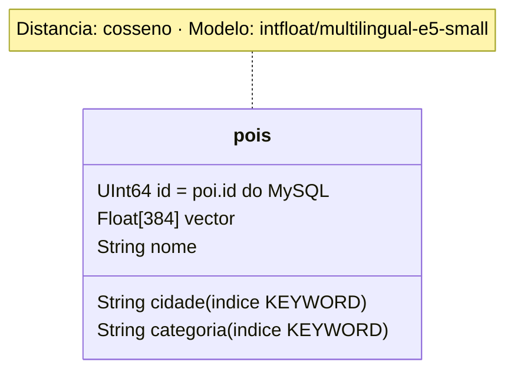

# Qdrant - estrutura do ponto



Texto que gera o vetor (com o prefixo `passage: `):

```
passage: <Nome>. Categoria: <categoria>. Cidade: <cidade>. <Descrição>
```

As pesquisas usam o prefixo `query: `.