# Base de dados relacional — MySQL

*Responsável: Ellah*

## Modelo e decisões

**O que guarda.** Dados estruturados e com relações bem definidas: utilizadores, destinos, categorias, POIs (nome, morada, descrição, preço médio) e favoritos.

**Como está organizada.** Cinco tabelas (`utilizador`, `destino`, `categoria`, `poi`, `favorito`). Diagrama ER em `docs/parte1/mysql_er.md` e esquema executável em `sql/schema.sql`.

**Relações.**
- Um destino tem muitos POIs e uma categoria classifica muitos POIs (1:N).
- Utilizadores e POIs relacionam-se de forma N:M através de `favorito`.

**Operações principais.**
- Leituras: listar POIs por destino e categoria, obter um POI, obter vários POIs pelos ids devolvidos pelo Qdrant, favoritos de um utilizador.
- Escritas: registar utilizador, adicionar ou remover favorito.

### Decisões de modelação e justificação

| Decisão | Justificação |
|---|---|
| Dados estruturados e relacionais no MySQL | Esquema fixo, relações bem definidas e necessidade de integridade referencial e de `JOIN`, que são o ponto forte do modelo relacional. |
| `poi.id` (`BIGINT UNSIGNED`) como identificador canónico das três bases | Permite cruzar MySQL, MongoDB e Qdrant sem ambiguidade. É compatível com os ids inteiros de 64 bits do Qdrant. |
| Descrição textual no `poi` | Fica junto dos restantes dados do POI e é a fonte do texto que gera os embeddings. |
| Chave primária `(utilizador_id, poi_id)` em `favorito` | Um utilizador não pode guardar o mesmo POI duas vezes. |
| Chaves estrangeiras e `ON DELETE CASCADE` em `favorito` | Impedem registos órfãos: apagar um utilizador ou um POI remove os seus favoritos. Só atua no MySQL (ver Consistência). |
| Ratings e comentários fora do MySQL | Após o feedback, passaram para o MongoDB, junto do POI (padrão Subset): são lidos sempre com o POI e crescem sem limite. |
| Localização fora do MySQL | Após o feedback, as coordenadas passaram para o MongoDB, que também tem índices geoespaciais. O MySQL fica só com dados estruturados e relações. |

### Desempenho

- Índices de chave primária e de unicidade (`email` em utilizador, `(nome, pais)` em destino).
- Índice composto `(destino_id, categoria_id)` em `poi`, para as listagens por destino e categoria.
- Índice em `favorito(poi_id)`. A chave primária `(utilizador_id, poi_id)` começa por `utilizador_id`, por isso só serve as consultas por utilizador; as consultas por POI precisam deste índice.
- A análise dos índices está no capítulo "Análise de índices".

### Escalabilidade

A tabela que mais cresce é `favorito`. O acesso faz-se sempre por `utilizador_id` ou `poi_id`, ambos indexados. A tabela `poi` cresce devagar.

### Consistência

O InnoDB garante transações ACID dentro do MySQL. Entre bases não há transações distribuídas: ao apagar um POI, a aplicação remove também o documento no MongoDB (ratings, comentários e localização) e o vetor no Qdrant.

### Manutenção

O esquema está versionado em `sql/schema.sql`, as regras de integridade estão na própria base (e não espalhadas pelo código) e a estrutura fixa torna as alterações explícitas e controladas.

## Implementação

- **Servidor:** MySQL 8.0 na cloud privada do DEI (template "MySQL Server v8.0"), com acesso externo ativado. A aplicação usa um utilizador próprio (`tourism_app`), com permissões apenas sobre a base `smart_tourism`; a conta `root` não é usada pela aplicação.
- **Credenciais:** lidas do ficheiro `.env`, que não vai para o repositório.
- **Acesso a dados:** `app/repositories/mysql/mysql_repository.py`. Os serviços não escrevem SQL: chamam as funções deste repositório. O teste `teste_mysql_repository.py` verifica as funções principais contra o servidor e apaga os dados de teste no fim.
- **Dados de teste:** carregados por `data/carregar_mysql.py`. Os 80 POIs (nome, descrição, cidade e categoria) são os mesmos indexados no Qdrant, com os mesmos ids. Os 2000 utilizadores e os 30 177 favoritos são **sintéticos**. O script usa uma semente fixa (gera sempre os mesmos dados) e, no fim, atualiza as estatísticas das tabelas (`ANALYZE TABLE`), para o otimizador escolher bem os índices.

## Queries principais

| Funcionalidade | Consulta |
|---|---|
| Página do POI | `SELECT … FROM poi JOIN destino JOIN categoria WHERE p.id = ?` |
| Pesquisa semântica (depois do Qdrant) | `… WHERE p.id IN (?, ?, …)`, devolvendo os POIs pela ordem do Qdrant |
| Navegar | `… WHERE p.destino_id = ? [AND p.categoria_id = ?]` (usa o índice composto) |
| Favoritos | `INSERT IGNORE INTO favorito …` (não duplica), `DELETE …`, `SELECT poi_id FROM favorito WHERE utilizador_id = ?` |