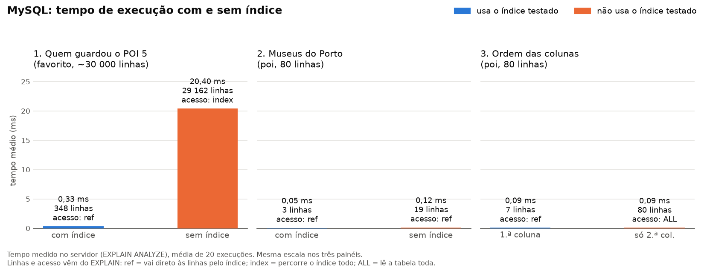

# Análise de índices

*Responsáveis: cada membro, na sua base*

Para cada cenário: a consulta, o índice criado, como foi medido, os resultados e a explicação. Incluir um caso em que o índice não traz benefício relevante.

## Cenário relacional (MySQL)

**Como medimos.** O script `benchmarks/indices_mysql.py` corre cada consulta em duas versões. Nos cenários 1 e 2, "sem índice" usa `IGNORE INDEX`, que impede o MySQL de usar aquele índice sem alterar o esquema. O plano vem do `EXPLAIN` e o tempo do `EXPLAIN ANALYZE`, medido dentro do servidor (para não incluir a rede), em média de 20 execuções. Dados: 80 POIs, 2000 utilizadores e 30 177 favoritos (sintéticos, gerados por `data/carregar_mysql.py`).

| Cenário | Versão | Acesso | Índice | Linhas (estim.) | Tempo médio |
|---|---|---|---|---|---|
| 1. Quem guardou o POI 5 (`favorito`, ~30 000 linhas) | com índice | `ref` | `ix_favorito_poi` | 348 | 0,33 ms |
| | sem índice | `index` | `PRIMARY` | 29 162 | 20,40 ms |
| 2. Museus do Porto (`poi`, 80 linhas) | com índice | `ref` | `ix_poi_destino_categoria` | 3 | 0,05 ms |
| | sem índice | `ref` | `fk_poi_categoria` | 19 | 0,12 ms |
| 3. Ordem das colunas em `(destino_id, categoria_id)` | só 1.ª coluna | `ref` | `ix_poi_destino_categoria` | 7 | 0,09 ms |
| | só 2.ª coluna | `ALL` | — | 80 | 0,09 ms |



Os tempos variam entre execuções, porque o servidor do DEI é partilhado; os planos e o número de linhas lidas mantiveram-se iguais em todas as execuções.

**Cenário 1: o índice compensa.** A tabela `favorito` tem volume e o filtro por `poi_id` é seletivo. Com o índice secundário na chave estrangeira, o MySQL vai direto às linhas desse POI (`ref`). Sem ele, percorre a chave primária inteira (`index`), porque a chave `(utilizador_id, poi_id)` começa por `utilizador_id` e não serve para procurar só por `poi_id`. A consulta fica muito mais lenta e lê cerca de 80 vezes mais linhas.

**Cenário 2: o índice não traz benefício relevante.** Com apenas 80 linhas, qualquer leitura é imediata e a diferença é de centésimas de milissegundo. Além disso, sem o índice composto o MySQL usou outro índice que já existia (o da chave estrangeira de `categoria_id`). Em tabelas pequenas, um índice adicional custa espaço e tempo nas escritas sem ganho nas leituras.

**Cenário 3: a ordem das colunas importa.** O índice `(destino_id, categoria_id)` está ordenado primeiro por `destino_id`. Uma pesquisa só por `destino_id` usa o índice (`ref`); uma pesquisa só por `categoria_id` não o consegue usar, e o MySQL lê a tabela inteira (`ALL`), mesmo com `FORCE INDEX`. Com apenas 80 linhas, o tempo é praticamente igual nas duas versões (nesta execução, a segunda foi até ligeiramente mais rápida): a diferença está no plano, não no tempo.

**Conclusão.** Os índices compensam quando a tabela tem volume e o filtro é seletivo, e só servem se a consulta usar as primeiras colunas do índice. Em tabelas pequenas, o ganho é desprezável.

## Cenário NoSQL (MongoDB)

### Consulta analisada

O cenário escolhido corresponde à consulta do histórico recente de interações de um utilizador. Esta operação é utilizada, por exemplo, para recuperar as últimas pesquisas e visualizações de pontos de interesse realizadas por um utilizador.

A consulta filtra os documentos pelo identificador do utilizador e ordena os resultados pela data da interação, da mais recente para a mais antiga, limitando o resultado aos 20 registos mais recentes.

```python
interactions = db.user_interactions.find(
    {"user_id": 1}
).sort(
    "timestamp", -1
).limit(20)
```

### Índice criado

Para otimizar esta consulta, foi criado um índice composto sobre os campos `user_id` e `timestamp`, respetivamente por ordem ascendente e descendente.

```python
db.user_interactions.create_index([
    ("user_id", 1),
    ("timestamp", -1)
])
```

A ordem dos campos é importante: o primeiro permite localizar as interações de um utilizador específico e o segundo permite obter os resultados já ordenados cronologicamente, evitando trabalho adicional de ordenação sempre que o índice é utilizado.

### Como foi medido

A avaliação foi realizada através do método `explain("executionStats")`, disponibilizado pelo MongoDB. Este método permite observar o plano de execução da consulta e recolher métricas sobre o trabalho realizado pelo motor da base de dados.

Foram analisadas as seguintes métricas:

- `executionTimeMillis`: tempo de execução da consulta, em milissegundos;
- `totalDocsExamined`: número de documentos examinados;
- `totalKeysExamined`: número de entradas do índice examinadas;
- `nReturned`: número de documentos devolvidos.

A comparação deve ser feita entre a execução sem utilização do índice e a execução com o índice composto. Para tornar a comparação explícita, pode utilizar-se `hint()` para forçar cada plano:

```python
# Execução sem utilização do índice
without_index = db.user_interactions.find(
    {"user_id": 1}
).sort(
    "timestamp", -1
).limit(20).hint("$natural").explain("executionStats")

# Execução com utilização do índice
with_index = db.user_interactions.find(
    {"user_id": 1}
).sort(
    "timestamp", -1
).limit(20).hint("user_id_1_timestamp_-1").explain("executionStats")
```

### Resultados

Os resultados devem ser preenchidos com os valores obtidos na execução dos testes:

| Métrica | Sem índice | Com índice |
|---|---:|---:|
| Tempo de execução (`executionTimeMillis`) | [valor] | [valor] |
| Documentos examinados (`totalDocsExamined`) | [valor] | [valor] |
| Entradas de índice examinadas (`totalKeysExamined`) | [valor] | [valor] |
| Documentos devolvidos (`nReturned`) | [valor] | [valor] |

### Explicação dos resultados

A utilização do índice composto permite ao MongoDB localizar diretamente as interações associadas ao utilizador e percorrê-las pela ordem temporal pretendida. Assim, evita, em condições normais, a leitura de todos os documentos da coleção e uma ordenação adicional dos resultados.

Espera-se, por isso, uma redução do número de documentos examinados e, dependendo do volume de dados e das condições de execução, uma melhoria do tempo de resposta. O impacto deve ser confirmado através dos resultados medidos.

### Caso em que o índice não traz benefício relevante

Foi também considerado o caso de uma consulta que pretende obter as 20 interações mais recentes de todos os utilizadores:

```python
recent_interactions = db.user_interactions.find(
    {}
).sort(
    "timestamp", -1
).limit(20)
```

O índice composto criado anteriormente não é adequado para esta consulta, porque começa pelo campo `user_id`, que não é utilizado como filtro. Consequentemente, não permite obter diretamente uma ordenação global por `timestamp`.

Neste cenário, o MongoDB poderá ter de examinar os documentos e executar uma operação de ordenação, pelo que o índice composto não deverá proporcionar um benefício relevante. Este comportamento deve ser confirmado através de `explain("executionStats")`.

Este exemplo demonstra que a criação de índices deve ter em conta os padrões reais de consulta da aplicação. Um índice pode melhorar significativamente determinadas operações, mas não ser útil para consultas com filtros ou ordenações diferentes.

### Considerações finais

O índice composto em `user_id` e `timestamp` foi escolhido por corresponder a uma operação frequente da aplicação: consultar o histórico recente de um utilizador. A sua utilidade deve ser avaliada através do número de documentos examinados, das entradas de índice percorridas e do tempo de execução.

Importa ainda considerar que os índices ocupam espaço adicional e introduzem algum custo nas operações de escrita, uma vez que têm de ser atualizados quando são inseridos, alterados ou removidos documentos.


## Cenário vetorial (Qdrant)
